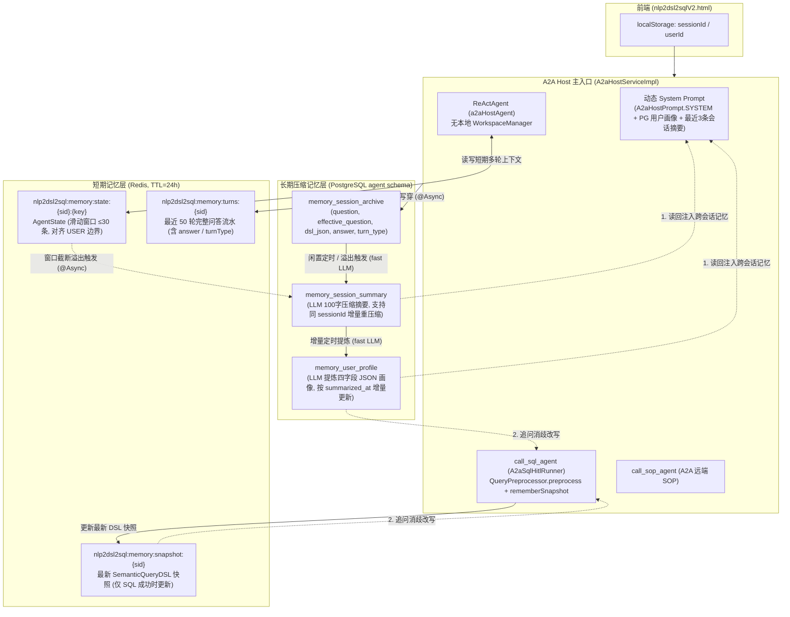

# 统一会话记忆架构改造计划（短期 Redis + 长期压缩 PG，移除本地 Workspace）

> **背景**：当前项目在 A2A Host 主入口下同时存在两套割裂的记忆机制：
> 1. **框架本地 Workspace 记忆**：[`A2aHostAgentFactory`](file:///Users/leo/project/testDemo/Nlp2dsl2sql/src/main/java/org/example/nlp2dsl2sql/a2a/A2aHostAgentFactory.java)（以及 [`Nlp2dsl2sqlAgent`](file:///Users/leo/project/testDemo/Nlp2dsl2sql/src/main/java/org/example/nlp2dsl2sql/agent/Nlp2dsl2sqlAgent.java)、[`Nlp2dsl2sqlSkillHarnessAgent`](file:///Users/leo/project/testDemo/Nlp2dsl2sql/src/main/java/org/example/nlp2dsl2sql/agent/Nlp2dsl2sqlSkillHarnessAgent.java)）使用 `HarnessAgent` 默认的本地 `JsonFileAgentStateStore`、进程内 [`A2aHostSessionManager`](file:///Users/leo/project/testDemo/Nlp2dsl2sql/src/main/java/org/example/nlp2dsl2sql/a2a/A2aHostSessionManager.java) 缓存及本地 `.agentscope/workspace*` 目录（落盘 `sessions/*.jsonl`、`memory/YYYY-MM-DD.md`、`MEMORY.md`）；
> 2. **自建 `service/memory` 记忆**：仅在 SQL 子 Agent（[`A2aSqlHitlRunner`](file:///Users/leo/project/testDemo/Nlp2dsl2sql/src/main/java/org/example/nlp2dsl2sql/a2a/A2aSqlHitlRunner.java)）生成 DSL 时触发，Redis 仅存 DSL 快照，PG 仅归档不含回答结论的 SQL 问句，且压缩出的 `memory_session_summary` 从未被任何 Prompt 读回，同一 `sessionId` 跨天复用后也无法增量更新摘要。

---

## 一、拍板决策汇总（Q1–Q8）

| 编号 | 决策项 | 结论 |
|---|---|---|
| **Q1** | 整体收敛方向 | **彻底移除本地 `.agentscope/workspace*` 文件记忆**（`MEMORY.md` / `*.jsonl`），短期上下文统一进 Redis，长期压缩记忆统一进 PG，合流为唯一一套记忆体系 |
| **Q2** | Redis 短期记忆职责 | Redis 同时承接 **Host 会话消息状态（`AgentStateStore`）** + **语义 DSL 快照（`snapshot`）** + **最近轮次视图（`turns`）**；废弃进程内 [`A2aHostSessionManager`](file:///Users/leo/project/testDemo/Nlp2dsl2sql/src/main/java/org/example/nlp2dsl2sql/a2a/A2aHostSessionManager.java)，统一走 `memory.session-ttl`（默认 24h） |
| **Q3** | Host Agent 类型与窗口控制 | [`A2aHostAgentFactory`](file:///Users/leo/project/testDemo/Nlp2dsl2sql/src/main/java/org/example/nlp2dsl2sql/a2a/A2aHostAgentFactory.java) 改用 `ReActAgent` + 自建 [`SpringRedisAgentStateStore`](file:///Users/leo/project/testDemo/Nlp2dsl2sql/src/main/java/org/example/nlp2dsl2sql/service/memory/impl/SpringRedisAgentStateStore.java)；保存 `AgentState` 时按完整对话轮次滑动截断（默认保留最近 `max-state-messages: 30` 条消息，对齐 `MsgRole.USER` 边界防止截断 `tool_call`） |
| **Q4** | PG 长期记忆写侧（采集） | [`memory_session_archive`](file:///Users/leo/project/testDemo/Nlp2dsl2sql/memory.sql) 新增 `answer`（回答结论，截断至 500 字）与 `turn_type`（`SQL` / `SOP` / `MIXED` / `CHITCHAT`）列；每轮对话结束统一归档完整问答与结论 |
| **Q5** | PG 长期记忆读侧（注入） | **双端消费**：A2A Host 启动时按 `userId` 从 PG 读取「用户画像 + 最近 K 条（默认 3 条）历史会话摘要」注入 Host 系统提示词尾部（替代原 `MEMORY.md`，同时保留“数据问题一律重查”铁律）；保留 [`QueryContextRewriter`](file:///Users/leo/project/testDemo/Nlp2dsl2sql/src/main/java/org/example/nlp2dsl2sql/service/memory/QueryContextRewriter.java) 追问改写时的画像注入 |
| **Q6** | 非 A2A 端点清理范围 | 全项目统一告别 `.agentscope/workspace*`：[`Nlp2dsl2sqlAgent`](file:///Users/leo/project/testDemo/Nlp2dsl2sql/src/main/java/org/example/nlp2dsl2sql/agent/Nlp2dsl2sqlAgent.java) 改用 `ReActAgent` + `SpringRedisAgentStateStore`；[`Nlp2dsl2sqlSkillHarnessAgent`](file:///Users/leo/project/testDemo/Nlp2dsl2sql/src/main/java/org/example/nlp2dsl2sql/agent/Nlp2dsl2sqlSkillHarnessAgent.java) 禁用全部本地 memory hooks / compaction / workspaceContext 并接入 `SpringRedisAgentStateStore` |
| **Q7** | 压缩触发时机与增量游标 | **双触发 + 游标修复**：① Redis `AgentState` 发生滑动窗口截断时，立即异步触发该会话的 PG 摘要压缩；② `@Scheduled` 定时任务改为 `MAX(a.created_at) > s.last_turn_at`（支持 `localStorage` 复用老 `sessionId` 增量重压缩），画像改为按 `s.summarized_at > p.updated_at` 增量提炼 |
| **Q8** | 复合问答粒度与查看端点 | SQL 子 Agent 成功时仅更新 Redis `snapshot`（防 SOP 冲掉 DSL 槽位）；Host 流 `ON_COMPLETE` 时按「一问一答一轮」汇总写入 Redis `turns` 与 PG `memory_session_archive`；[`MemoryController`](file:///Users/leo/project/testDemo/Nlp2dsl2sql/src/main/java/org/example/nlp2dsl2sql/controller/MemoryController.java) 补充展示 Redis 会话状态消息数；清理 `.agentscope/workspace*` |

---

## 二、目标架构图



---

## 三、数据库与配置变更设计

### 3.1 DDL 变更（[`memory.sql`](file:///Users/leo/project/testDemo/Nlp2dsl2sql/memory.sql)）

在 `agent.memory_session_archive` 表新增 `answer` 与 `turn_type` 字段（提供完整建表语句与增量 `ALTER TABLE ... ADD COLUMN IF NOT EXISTS` 兼容已有库）：

```sql
CREATE TABLE IF NOT EXISTS agent.memory_session_archive (
    id                  BIGSERIAL PRIMARY KEY,
    session_id          VARCHAR(64) NOT NULL,
    user_id             VARCHAR(64),
    question            TEXT NOT NULL,
    effective_question  TEXT,
    dsl_json            TEXT,
    answer              TEXT,
    turn_type           VARCHAR(16) NOT NULL DEFAULT 'SQL',
    question_embedding  vector(1024),
    created_at          TIMESTAMPTZ NOT NULL DEFAULT now()
);

-- 兼容已建表环境的幂等升级语句
ALTER TABLE agent.memory_session_archive ADD COLUMN IF NOT EXISTS answer TEXT;
ALTER TABLE agent.memory_session_archive ADD COLUMN IF NOT EXISTS turn_type VARCHAR(16) NOT NULL DEFAULT 'SQL';
```

### 3.2 配置项扩展（[`application.yaml`](file:///Users/leo/project/testDemo/Nlp2dsl2sql/src/main/resources/application.yaml) & [`MemoryProperties.java`](file:///Users/leo/project/testDemo/Nlp2dsl2sql/src/main/java/org/example/nlp2dsl2sql/config/MemoryProperties.java)）

```yaml
memory:
  session-ttl: 24h
  # 短期 AgentState 消息滑动窗口上限（超限时按 USER 消息边界截断并异步触发 PG 摘要压缩）
  max-state-messages: 30
  # 单轮回答落库/落 Redis 时的最大截断字符数
  answer-max-chars: 500
  longterm:
    archive-enabled: true
    jobs-enabled: true
    turns-keep: 50
    summary:
      idle-minutes: 30
      scan-fixed-delay-ms: 600000
      # A2A Host 启动时注入最近多少条历史会话摘要
      inject-recent-count: 3
      inject-max-chars: 400
    profile:
      refresh-fixed-delay-ms: 3600000
      max-chars: 300
```

---

## 四、分阶段详细改动清单

### Phase 1：Redis 短期会话状态存储 + 彻底移除本地 Workspace

1. **新增 [`SpringRedisAgentStateStore.java`](file:///Users/leo/project/testDemo/Nlp2dsl2sql/src/main/java/org/example/nlp2dsl2sql/service/memory/impl/SpringRedisAgentStateStore.java)**（实现 `io.agentscope.core.state.AgentStateStore`）：
   - 键格式：
     - 单值状态：`nlp2dsl2sql:memory:state:{sessionId}:{stateKey}`（String，TTL = `memory.session-ttl`）
     - 列表状态：`nlp2dsl2sql:memory:state-list:{sessionId}:{stateKey}`（String JSON 数组，TTL = `memory.session-ttl`）
   - 序列化：使用框架内置 `io.agentscope.core.util.JsonUtils.getJsonCodec()` 对 `State`（主要是 `AgentState`）做 JSON 编解码。
   - **滑动窗口截断逻辑**：
     - 在 `save(userId, sessionId, key, state)` 中，若 `state instanceof AgentState agentState` 且 `agentState.getContext().size() > memoryProperties.getMaxStateMessages()`：
     - 从 `context.size() - maxStateMessages` 位置向后寻找第一个 `MsgRole.USER` 消息索引 `cutIdx`（若 index 0 是 `MsgRole.SYSTEM` 则保留 index 0，删除 `[1, cutIdx)` 区间；否则删除 `[0, cutIdx)` 区间），保证不会留下孤立的 `TOOL` 或半截 `tool_call`。
     - 截断发生时，发布/调用异步摘要触发回调（`SessionEvictionListener` / `MemorySummaryJob#summarizeSessionAsync(sessionId, userId)`），将已落库 `memory_session_archive` 的早期轮次立即压缩进 PG `memory_session_summary`。
   - **故障降级**：Redis 读写任何异常均 catch 并 `log.warn`，`get` 返回 `Optional.empty()`，绝不阻断对话。
   - 辅助查看方法：`int getContextMessageCount(String sessionId)` 供 `MemoryController` 展示。

2. **重构 [`A2aHostAgentFactory.java`](file:///Users/leo/project/testDemo/Nlp2dsl2sql/src/main/java/org/example/nlp2dsl2sql/a2a/A2aHostAgentFactory.java) 与移除 [`A2aHostSessionManager.java`](file:///Users/leo/project/testDemo/Nlp2dsl2sql/src/main/java/org/example/nlp2dsl2sql/a2a/A2aHostSessionManager.java)**：
   - `A2aHostAgentFactory` 返回类型由 `HarnessAgent` 改为 `ReActAgent`（与 [`SqlQueryHitlAgentFactory`](file:///Users/leo/project/testDemo/Nlp2dsl2sql/src/main/java/org/example/nlp2dsl2sql/a2a/SqlQueryHitlAgentFactory.java) 一致）：
     - 配置 `.name("a2aHostAgent")`、`.sysPrompt(sysPrompt)`、`.model(model)`、`.toolkit(toolkit)`、`.maxIters(10)`、`.enablePendingToolRecovery(true)`、`.stateStore(redisAgentStateStore)`、`.middleware(traceMiddleware)`。
     - 支持 `create(Model model, String customSysPrompt)` 重载以便注入用户的 PG 长期记忆（画像 + 近期摘要）。
   - 删除进程内缓存 [`A2aHostSessionManager.java`](file:///Users/leo/project/testDemo/Nlp2dsl2sql/src/main/java/org/example/nlp2dsl2sql/a2a/A2aHostSessionManager.java)；[`A2aHostServiceImpl`](file:///Users/leo/project/testDemo/Nlp2dsl2sql/src/main/java/org/example/nlp2dsl2sql/service/impl/A2aHostServiceImpl.java) 直接通过 `A2aHostAgentFactory` 创建无状态 `ReActAgent` 实例（会话状态由 `SpringRedisAgentStateStore` 按 `RuntimeContext(userId, sessionId)` 自动加载与回写）。

3. **清理 [`Nlp2dsl2sqlAgent.java`](file:///Users/leo/project/testDemo/Nlp2dsl2sql/src/main/java/org/example/nlp2dsl2sql/agent/Nlp2dsl2sqlAgent.java) 与 [`Nlp2dsl2sqlSkillHarnessAgent.java`](file:///Users/leo/project/testDemo/Nlp2dsl2sql/src/main/java/org/example/nlp2dsl2sql/agent/Nlp2dsl2sqlSkillHarnessAgent.java) 的本地 Workspace**：
   - `Nlp2dsl2sqlAgent`：移除 `.workspace(...)` 与 `.compaction(...)`，开启 `.disableMemoryHooks()`、`.disableMemoryTools()`、`.disableSessionPersistence()`、`.disableWorkspaceContext()`、`.disableCompaction()`、`.disableFilesystemTools()`、`.disableShellTool()`、`.disableSubagents()`、`.disableDynamicSubagents()`、`.disableDefaultWorkspaceSkills()`、`.disableAtPathExpansion()`、`.disableToolsConfig()`，并注入 `.stateStore(redisAgentStateStore)`。
   - `Nlp2dsl2sqlSkillHarnessAgent`：同样禁用上述全部本地 memory/workspace 钩子与 compaction，注入 `.stateStore(redisAgentStateStore)`。
   - 删除工作区下残留的 `.agentscope/workspace` 和 `.agentscope/workspace-a2a-host` 目录。

---

### Phase 2：Host 级全量轮次归档（含 `answer` 与 `turn_type`）与职责切分

1. **扩展快照与流水模型**：
   - [`SemanticSessionSnapshot.java`](file:///Users/leo/project/testDemo/Nlp2dsl2sql/src/main/java/org/example/nlp2dsl2sql/models/dto/dsl/SemanticSessionSnapshot.java)：新增可选字段 `String answer`（截断后的回答摘要）和 `String turnType`（默认 `"SQL"`，取值 `SQL` / `SOP` / `MIXED` / `CHITCHAT`）。
   - [`MemorySessionArchive.java`](file:///Users/leo/project/testDemo/Nlp2dsl2sql/src/main/java/org/example/nlp2dsl2sql/models/entity/memory/MemorySessionArchive.java)：新增 `String answer` 与 `String turnType` 字段。

2. **切分 [`SessionSnapshotStore.java`](file:///Users/leo/project/testDemo/Nlp2dsl2sql/src/main/java/org/example/nlp2dsl2sql/service/memory/SessionSnapshotStore.java) 与 [`RedisSessionSnapshotStore.java`](file:///Users/leo/project/testDemo/Nlp2dsl2sql/src/main/java/org/example/nlp2dsl2sql/service/memory/impl/RedisSessionSnapshotStore.java) 的快照更新与轮次追加**：
   - `putSnapshot(String sessionId, SemanticSessionSnapshot snapshot)`：仅更新 `nlp2dsl2sql:memory:snapshot:{sessionId}`（仅当 `snapshot.getDsl() != null` 时调用，确保纯 SOP 问答或闲聊不会覆盖上一轮的 SQL 语义槽位）。
   - `appendTurn(String sessionId, SemanticSessionSnapshot turn)`：LPUSH 到 `nlp2dsl2sql:memory:turns:{sessionId}` 并 LTRIM 保留 `turns-keep`（50）条，刷新 TTL。
   - 保留原有 `put(sessionId, snapshot)` 默认同时调用 `putSnapshot` + `appendTurn` 以兼容非 A2A 模式。

3. **升级 [`QueryPreprocessor.java`](file:///Users/leo/project/testDemo/Nlp2dsl2sql/src/main/java/org/example/nlp2dsl2sql/service/memory/QueryPreprocessor.java) 与 [`MemoryArchiveWriter.java`](file:///Users/leo/project/testDemo/Nlp2dsl2sql/src/main/java/org/example/nlp2dsl2sql/service/memory/MemoryArchiveWriter.java)**：
   - 新增 `rememberSnapshotOnly(String sessionId, String rawQuestion, String effectiveQuestion, SemanticQueryDSL dsl)`：供 [`A2aSqlHitlRunner`](file:///Users/leo/project/testDemo/Nlp2dsl2sql/src/main/java/org/example/nlp2dsl2sql/a2a/A2aSqlHitlRunner.java) 在每次 SQL 子查询生成 DSL 后立即更新 Redis `snapshot`（支持同一复合问题内的第二个 SQL 子问题或下一轮追问立即继承）。
   - 新增 `rememberTurn(String sessionId, String userId, String rawQuestion, String effectiveQuestion, SemanticQueryDSL dsl, String answer, String turnType)`：
     - 将 `answer` 按 `memory.answer-max-chars`（默认 500 字）安全截断；
     - 若 `dsl != null` 同步更新 `putSnapshot`；
     - 调用 `store.appendTurn(...)` 写入 Redis `turns`；
     - 调用 `archiveWriter.writeAsync(sessionId, resolvedUserId, rawQuestion, effectiveQuestion, dsl, truncatedAnswer, turnType)` 异步写穿 PG `memory_session_archive`。
   - 原有 4 参/5 参 `remember(...)` 保持兼容，委托给 `rememberTurn(..., null, "SQL")`。

4. **在 [`A2aHostChatContext.java`](file:///Users/leo/project/testDemo/Nlp2dsl2sql/src/main/java/org/example/nlp2dsl2sql/a2a/A2aHostChatContext.java)、[`A2aRemoteAgentTools.java`](file:///Users/leo/project/testDemo/Nlp2dsl2sql/src/main/java/org/example/nlp2dsl2sql/a2a/A2aRemoteAgentTools.java)、[`A2aSqlHitlRunner.java`](file:///Users/leo/project/testDemo/Nlp2dsl2sql/src/main/java/org/example/nlp2dsl2sql/a2a/A2aSqlHitlRunner.java) 与 [`A2aHostServiceImpl.java`](file:///Users/leo/project/testDemo/Nlp2dsl2sql/src/main/java/org/example/nlp2dsl2sql/service/impl/A2aHostServiceImpl.java) 中串联一问一答归档**：
   - `A2aHostChatContext` 增加线程安全的本轮执行轨迹记录：`recordSqlTurn(String effectiveQuery, SemanticQueryDSL dsl)`、`recordSopCall()`、`appendHostAnswer(String delta)`，以及计算 `resolveTurnType()`（既调了 SQL 又调了 SOP 为 `MIXED`，仅 SQL 为 `SQL`，仅 SOP 为 `SOP`，未调工具为 `CHITCHAT`）。
   - `A2aSqlHitlRunner`：将原来的 `queryPreprocessor.remember(...)` 改为 `queryPreprocessor.rememberSnapshotOnly(...)` + `hostCtx.recordSqlTurn(effectiveQuery, sqlSession.getDsl())`。
   - `A2aRemoteAgentTools#callSopAgent`：记录 `hostCtx.recordSopCall()`。
   - `A2aHostServiceImpl#chat`：在 `TextBlockDeltaEvent` 中累积 Host 最终自然语言回答；当流正常完成（`SignalType.ON_COMPLETE`）时，调用 `queryPreprocessor.rememberTurn(sid, uid, trimmed, hostCtx.getLastEffectiveQueryOrDefault(trimmed), hostCtx.getLastDsl(), hostCtx.getHostAnswer(), hostCtx.resolveTurnType())`。

---

### Phase 3：PG 长期压缩双触发 + 增量游标修复 + Host 跨会话读回注入

1. **修复 [`MemorySessionArchiveMapper.java`](file:///Users/leo/project/testDemo/Nlp2dsl2sql/src/main/java/org/example/nlp2dsl2sql/mapper/memory/MemorySessionArchiveMapper.java) 的增量候选查询**：
   - 原 SQL 使用 `NOT IN (SELECT session_id FROM memory_session_summary)`，导致复用 `sessionId` 永远不再更新摘要。
   - 改为 `LEFT JOIN memory_session_summary s ON a.session_id = s.session_id`：
     ```sql
     SELECT a.session_id AS "sessionId", MAX(a.user_id) AS "userId",
            MAX(a.created_at) AS "lastTurnAt", COUNT(*) AS "turnCount"
     FROM memory_session_archive a
     LEFT JOIN memory_session_summary s ON a.session_id = s.session_id
     GROUP BY a.session_id, s.last_turn_at
     HAVING MAX(a.created_at) < now() - (#{idleMinutes} * interval '1 minute')
        AND (s.last_turn_at IS NULL OR MAX(a.created_at) > s.last_turn_at)
     ```

2. **升级 [`MemorySummaryJob.java`](file:///Users/leo/project/testDemo/Nlp2dsl2sql/src/main/java/org/example/nlp2dsl2sql/service/memory/MemorySummaryJob.java)（含回答结论压缩 + 窗口溢出即时异步触发）**：
   - `buildTurnsText(turns)` 拼入 `[类型:{turnType}] 问:{question} 改写:{effectiveQuestion} 答:{answer}`，使 fast LLM 能真正压缩出包含问答结论的 100 字摘要。
   - 新增 `@Async("memoryArchiveExecutor") public void summarizeSessionAsync(String sessionId, String userId)`（并用 `ConcurrentHashMap.newKeySet()` 做单会话并发去重防抖）：供 `SpringRedisAgentStateStore` 在发生滑动窗口消息截断时立即异步触发该会话摘要更新。

3. **修复 [`MemoryProfileJob.java`](file:///Users/leo/project/testDemo/Nlp2dsl2sql/src/main/java/org/example/nlp2dsl2sql/service/memory/MemoryProfileJob.java) 的增量提炼条件**：
   - 原逻辑仅按 `id > summary_seen` 过滤，当老 `sessionId` 通过 `ON CONFLICT (session_id) DO UPDATE` 更新摘要时 `id` 不变，导致画像不更新。
   - 改为：查询该用户满足 `id > summary_seen OR summarized_at > #{profileUpdatedAt}` 的摘要记录进行增量提炼，提炼成功后 `upsert` 刷新 `summary_seen = maxId` 与 `updated_at = now()`。

4. **增强 [`MemoryProfileService.java`](file:///Users/leo/project/testDemo/Nlp2dsl2sql/src/main/java/org/example/nlp2dsl2sql/service/memory/MemoryProfileService.java) 并在 [`A2aHostServiceImpl.java`](file:///Users/leo/project/testDemo/Nlp2dsl2sql/src/main/java/org/example/nlp2dsl2sql/service/impl/A2aHostServiceImpl.java) 注入跨会话长期记忆**：
   - 在 `MemorySessionSummaryMapper` 新增按 `userId` 查询最近 N 条摘要的方法（`ORDER BY summarized_at DESC LIMIT #{limit}`）。
   - 在 `MemoryProfileService` 新增 `buildHostLongTermMemoryContext(String userId)`：
     - 从 PG 读取该用户的 `profile_json`（截断 `profile.max-chars`）与最近 3 条 `memory_session_summary`（总长截断 `summary.inject-max-chars`）；
     - 若均为空返回空串；否则组装为 `## 用户长期记忆（跨会话背景，仅供参考指代与偏好；数据问题仍必须调用 call_sql_agent 实时查询）` 段落，拼到 `A2aHostPrompt.SYSTEM` 尾部传给 `A2aHostAgentFactory`。
   - 在 [`MemoryController.java`](file:///Users/leo/project/testDemo/Nlp2dsl2sql/src/main/java/org/example/nlp2dsl2sql/controller/MemoryController.java) 的 `GET /aiChat/memory/session/{sessionId}` 返回体中新增 `stateMessageCount` 字段，直观展示 Redis `AgentStateStore` 当前缓存的短期对话消息条数。

5. **文档与单测同步**：
   - 更新 [`docs/adr/0003-tiered-session-memory.md`](file:///Users/leo/project/testDemo/Nlp2dsl2sql/docs/adr/0003-tiered-session-memory.md) 与 [`AGENTS.md`](file:///Users/leo/project/testDemo/Nlp2dsl2sql/AGENTS.md)（移除“MEMORY.md 并存”表述，更新为统一的 Redis 短期 + PG 长期压缩架构）。
   - 新增 [`SpringRedisAgentStateStoreTest.java`](file:///Users/leo/project/testDemo/Nlp2dsl2sql/src/test/java/org/example/nlp2dsl2sql/service/memory/impl/SpringRedisAgentStateStoreTest.java)（覆盖存取、滑动窗口按 `USER` 边界截断、截断触发异步摘要、Redis 异常静默降级），并更新现有 `QueryPreprocessorTest`、`RedisSessionSnapshotStoreTest`、`MemoryArchiveWriterTest`、`MemorySummaryJobTest`、`MemoryProfileJobTest`、`A2aHostServiceImplConfirmTest`。
   - 执行 `mvn clean compile && mvn test` 确保全部单测通过。
